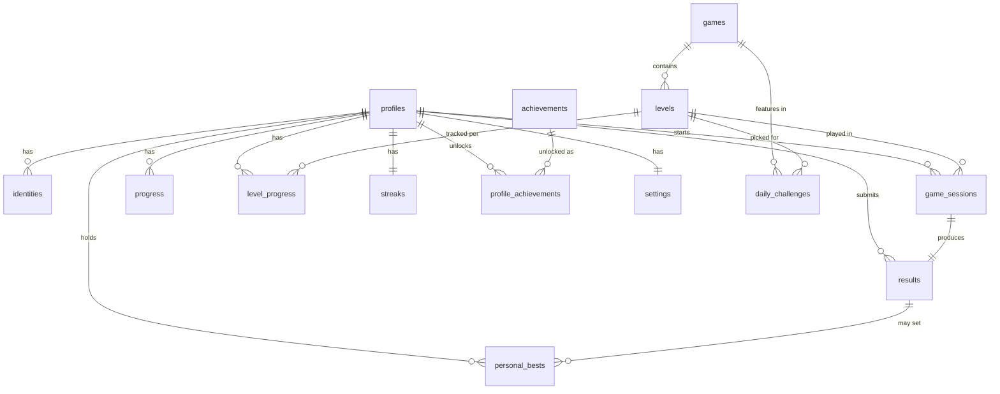

# DATABASE.md

Postgres schema (via Supabase), as SQL migrations in `/supabase/migrations`, applied in filename
order. See `.env.example` for the two client-side env vars and `SECURITY.md` (Phase 2 checkpoint)
for the auth flows that write to this schema.

## ER diagram



## Tables

| Table                                   | Purpose                                                                                                                              | Client write access                                                                                       |
| --------------------------------------- | ------------------------------------------------------------------------------------------------------------------------------------ | --------------------------------------------------------------------------------------------------------- |
| `profiles`                              | One row per `auth.users` row (id shared).                                                                                            | Read/update own row only. Row is created by the `handle_new_user` trigger, never a client `INSERT`.       |
| `identities`                            | Links a profile to its auth providers (`anonymous`/`telegram`/`email`/`google`), unique per `(provider, provider_user_id)`.          | Read own only.                                                                                            |
| `games`                                 | The 8 games — static content, mirrors `src/games/registry.ts`.                                                                       | Public read.                                                                                              |
| `levels`                                | Levels per game/mode/difficulty; `payload` is the game-specific puzzle data, `seed` is what makes a level reproducible.              | Public read.                                                                                              |
| `daily_challenges`                      | One `(game_id → level_id)` pick per date — the "Daily Unwind" set.                                                                   | Public read.                                                                                              |
| `game_sessions`                         | A server-issued round in progress, with the server's own `seed` copied from the level.                                               | None — only via `start_session()`.                                                                        |
| `results`                               | A submitted round outcome; `is_valid=false` flags (not deletes) implausible submissions.                                             | None — only via `submit_result()`.                                                                        |
| `personal_bests`                        | Best score/time per `(profile, game, mode, difficulty)`; kept in sync by the `results_upsert_personal_best` trigger.                 | None (trigger-maintained).                                                                                |
| `level_progress`                        | Per-level best stars + completion count — the aggregation source for `progress`, so replays can't double-count stars.                | None — only via `submit_result()`.                                                                        |
| `progress`                              | Per-game rollup (`highest_level`, `stars_total`, `completed_count`) plus `saved_state` for resuming an unfinished puzzle.            | `saved_state` only, via `save_resume_state()` — the rest is `submit_result()`-maintained.                 |
| `streaks`                               | Timezone-aware daily streak counter.                                                                                                 | None — only via `submit_result()`.                                                                        |
| `achievements` / `profile_achievements` | Achievement definitions (`criteria` jsonb) and unlocks.                                                                              | Achievements: public read. Unlocks: read own; granted server-side (not yet wired to a trigger — Phase 7). |
| `settings`                              | Sound/music/haptics/relax-mode/theme/language. Not score-relevant, so unlike everything above, this **is** directly client-writable. | Insert/update own row.                                                                                    |
| `events`                                | First-party, in-house analytics only — no third-party trackers.                                                                      | Insert own (append-only); read own.                                                                       |

## RLS

Every table has RLS enabled from its own migration, not retrofitted later. The pattern throughout:
read policies check `auth.uid() = profile_id` (or `= id` for `profiles`); public-content tables
(`games`, `levels`, `daily_challenges`, `achievements`) allow `select using (true)`; and every
table that feeds scoring/progress/streaks has **no** client insert/update policy at all — those
only change through the `SECURITY DEFINER` functions below, which run as the table owner and can
apply checks a client-side `INSERT` would just skip.

## RPCs (`0008_session_rpcs.sql`)

- **`start_session(game_id, level_id, client_platform)`** — the only way a `game_sessions` row is
  created. Copies `seed` from the `levels` row server-side, so the client always plays the seed the
  server issued, never one it picked itself.
- **`submit_result(session_id, score, time_ms, moves?, hints_used?, mistakes?)`** — the only way a
  `results` row is created. Looks up the caller's own active session (`for update`, so concurrent
  submits on the same session can't race), flags `is_valid = false` if `time_ms` is implausible
  against the server's own elapsed-time clock (`< 300ms` or more than 2s ahead of actual elapsed
  time), computes stars from the level's `star_thresholds` jsonb (`{"1": …, "2": …, "3": …}`),
  inserts the result, closes the session, and — only for valid results — updates
  `level_progress`/`progress` (via aggregation, not increment) and the timezone-aware `streaks`
  counter.
- **`save_resume_state(game_id, state)`** — a plain upsert into `progress.saved_state`. Deliberately
  separate from the scoring path: there's nothing to cheat by saving your own in-progress board.

## Leaderboards (`0007_leaderboards.sql`)

Four `SECURITY DEFINER` functions, not a plain view — they read `personal_bests`/`results`/
`profiles` despite those tables' owner-only RLS, but only ever project out `display_name`,
`avatar_mood`, score and time, never a raw profile row:

- `alltime_leaderboard(game_id, mode, difficulty, limit)` / `my_alltime_rank(...)` — ranked over
  `personal_bests`.
- `weekly_leaderboard(...)` / `my_weekly_rank(...)` — ranked over each player's best **valid**
  `results` row since `date_trunc('week', now())`, so it resets every week without a separate
  materialization.

Tie-break everywhere: higher score → lower time → earlier `achieved_at`/`submitted_at`. The
`my_*_rank` functions exist so a player's own rank can be shown even when they're outside the
`limit`-sized top list.

If this needs to scale past what a live `rank()` query comfortably handles, the migration to add is
a materialized view refreshed on a schedule — not needed yet with zero real traffic.

## Migration workflow

```bash
supabase link --project-ref <your-project-ref>
supabase db push              # applies everything in /supabase/migrations in order
psql "$DATABASE_URL" -f supabase/seed/games.sql   # or run it in the SQL editor
```

`supabase/functions/telegram-auth` deploys separately (`supabase functions deploy telegram-auth`)
and needs `TELEGRAM_BOT_TOKEN` set via `supabase secrets set` — see that file's header comment.

**Not yet exercised against a live project** (none exists yet) — the SQL is written directly against
the documented Postgres/RLS/`rank()` semantics and should get a real smoke test (seed data, a
`start_session`→`submit_result` round trip, a leaderboard query) as soon as a Supabase project
exists.
